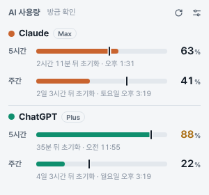

# AI 사용량 (크롬 확장 프로그램)

크롬 오른쪽 위 확장 프로그램 아이콘에 **마우스를 올리면** Claude와 ChatGPT(Codex)의 **5시간 한도, 주간 한도를 몇 % 썼는지**, 언제 다시 채워지는지 바로 보여줘요.



## 무엇을 보여주나요

- **아이콘에 마우스를 올리면**: 이런 글이 떠요.
  ```
  AI 사용량
  Claude  5시간 63% (2시간 11분 뒤 초기화)  주간 41% (2일 4시간 뒤 초기화)
  ChatGPT  5시간 88% (35분 뒤 초기화)  주간 22% (4일 3시간 뒤 초기화)
  방금 확인 · 누르면 자세히 보기
  ```
- **아이콘 위 숫자**: 두 서비스 중 더 많이 쓴 5시간 한도(%)예요. 초록 → 노랑(80% 이상) → 빨강(95% 이상)으로 바뀌어요. **!** 가 보이면 로그인이 필요하다는 뜻이에요.
- **아이콘을 누르면**: Claude는 주황색, ChatGPT는 초록색 막대로 자세히 보여줘요. 이름을 누르면 그 사이트의 사용량 페이지가 열려요.
- **알림**: 80%, 95%를 넘으면 알림이 뜨고, 넘었던 한도가 다시 채워지면 "다시 채워졌어요" 알림이 떠요.
- 1분마다 저절로 다시 확인해요.

## 설치하기

### 1. 파일 받기

1. 크롬에서 https://github.com/makerskim/web1/releases 를 열어요. GitHub 로그인은 필요 없어요.
2. 맨 위에 있는 **AI 사용량 크롬 확장 프로그램** 항목 아래쪽 **Assets** 에서 `AI-Usage-Extension-2.0.0.zip` 을 눌러 내려받아요.
3. 내려받은 압축 파일을 마우스 오른쪽 버튼으로 누르고 **모두 압축 풀기** (또는 **압축 풀기**)를 눌러요.
4. 압축을 푼 폴더를 지우거나 옮기지 않을 곳에 두세요. 예: **문서** 폴더 안. 크롬이 이 폴더에서 확장 프로그램을 읽어요.

### 2. 크롬에 넣기

1. 크롬 주소창(맨 위 글자 입력 칸)에 `chrome://extensions` 를 입력하고 **Enter** 를 눌러요.
2. 화면 오른쪽 위의 **개발자 모드** 스위치를 눌러 켜요.
3. 왼쪽 위에 새로 생긴 **압축해제된 확장 프로그램을 로드합니다** 버튼을 눌러요.
4. 폴더를 고르는 창이 열리면, 앞에서 압축을 푼 폴더(안에 `manifest.json` 파일이 보이는 폴더)를 고르고 **폴더 선택** 을 눌러요.
5. 목록에 **AI 사용량** 이 생기면 설치 끝이에요.

### 3. 아이콘을 항상 보이게 고정하기

1. 크롬 오른쪽 위의 **퍼즐 조각 모양 아이콘**(확장 프로그램)을 눌러요.
2. 목록에서 **AI 사용량** 옆의 **압정 모양** 을 눌러요.
3. 이제 주소창 오른쪽에 AI 사용량 아이콘이 항상 보여요. 마우스를 올리면 사용량이 떠요.

### 4. 로그인 확인

- 이 크롬에서 **claude.ai** 와 **chatgpt.com** 에 로그인되어 있으면 따로 할 일은 없어요.
- 아이콘에 **!** 가 보이면, 아이콘을 누르고 **claude.ai 열어서 로그인** (또는 **chatgpt.com 열어서 로그인**) 버튼을 눌러 로그인하세요. 1분 안에 숫자가 나타나요.

## 새 버전으로 바꿀 때

1. 위 **1. 파일 받기** 처럼 새 압축 파일을 받아서 풀어요.
2. 예전 폴더 안의 파일을 모두 지우고, 새로 푼 파일을 그 폴더에 넣어요.
3. `chrome://extensions` 에서 **AI 사용량** 칸의 **동그란 화살표(새로고침)** 버튼을 눌러요.

## 알아 두실 점

- **숫자의 출처**: claude.ai와 chatgpt.com의 사용량 페이지가 쓰는 곳에서 그대로 가져와요. 두 회사 모두 공식으로 공개한 기능이 아니라서, 사이트가 바뀌면 숫자가 안 보일 수 있어요. ChatGPT 숫자는 Codex(코딩 도구) 한도예요.
- **로그인 정보는 밖으로 나가지 않아요**: 이 크롬의 로그인으로 claude.ai와 chatgpt.com에만 물어봐요. 다른 곳으로는 아무것도 보내지 않아요.
- **"개발자 모드 확장 프로그램을 사용 중지하세요"** 같은 안내가 크롬을 켤 때 뜰 수 있어요. 크롬 웹 스토어를 거치지 않고 직접 넣은 확장 프로그램이라 뜨는 안내예요. **닫기**(또는 ✕)를 누르면 돼요.

---

## 개발자용

```bash
cd usage-extension
npm test        # 테스트 (설치할 것 없음)
```

- `background.js` – 1분마다 확인, 아이콘의 숫자와 마우스를 올렸을 때 글, 알림
- `src/usage.js` – claude.ai / chatgpt.com 에서 한도 읽기
- `src/logic.js` – 마우스를 올렸을 때 글, 아이콘 숫자, 알림 기준
- `popup.*` – 아이콘을 눌렀을 때 창 (글꼴: Pretendard, SIL Open Font License)
- `.github/workflows/usage-extension.yml` 이 압축 파일을 만들어 Releases 페이지에 올려요. 버전은 `manifest.json` 의 `version` 이에요.
