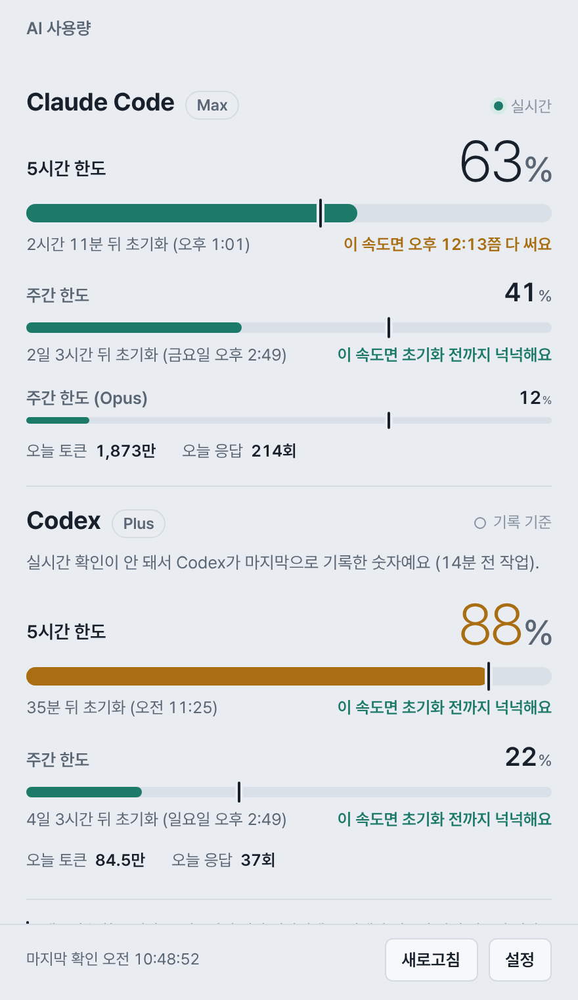

# AI 사용량

Claude Code와 Codex(ChatGPT 코딩 도구)를 쓰는 동안 **5시간 한도와 주간 한도를 몇 % 썼는지, 언제 다시 채워지는지**를 늘 보여주는 Windows 프로그램이에요.



## 무엇을 보여주나요

- **한도 비율**: 5시간 한도, 주간 한도 각각 몇 % 썼는지 큰 숫자와 막대로 보여줘요.
- **세로선**: 막대 위 세로선은 한도 기간 중 지금까지 지난 시간이에요. 막대가 세로선보다 앞서 있으면 기간이 끝나기 전에 한도가 먼저 찰 수 있다는 뜻이에요.
- **예상**: "이 속도면 오후 3:40쯤 다 써요"처럼 지금 쓰는 속도로 계산한 예상을 보여줘요.
- **다시 채워지는 시간**: 남은 시간이 1초마다 줄어들어요.
- **오늘 쓴 양**: 오늘 주고받은 토큰 수와 응답 횟수.
- **알림**: 80%, 95%를 넘으면 Windows 알림을 띄워요. 기준은 설정에서 바꿀 수 있어요.
- **작업 표시줄 아이콘**: 창을 닫아도 화면 오른쪽 아래 작업 표시줄에 남아서 계속 확인해요. 아이콘 색이 초록(여유) → 노랑(주의) → 빨강(위험)으로 바뀌고, 마우스를 올리면 비율이 보여요.

## 설치하기

### 1. 설치 파일 받기

1. 웹 브라우저(크롬, 엣지 등)로 이 저장소의 GitHub 페이지를 열어요.
2. 위쪽 메뉴에서 **Actions** 를 눌러요.
3. 왼쪽 목록에서 **Build usage monitor** 를 눌러요.
4. 오른쪽에 나오는 목록 중 맨 위에 있는, 초록색 체크 표시가 붙은 줄을 눌러요.
5. 페이지 아래쪽 **Artifacts** 부분에서 **AI-Usage-Monitor-Setup** 을 눌러요. 압축 파일(.zip)이 내려받아져요.
6. 내려받은 압축 파일을 마우스 오른쪽 버튼으로 누르고 **압축 풀기** (또는 **모두 압축 풀기**)를 눌러요. 안에 `AI-Usage-Monitor-Setup-1.0.0.exe` 파일이 있어요.

### 2. 설치 파일 실행하기

1. `AI-Usage-Monitor-Setup-1.0.0.exe` 를 두 번 눌러 실행해요.
2. 파란 창에 **"Windows의 PC 보호"** 라는 경고가 뜰 수 있어요. 회사 인증서로 서명하지 않은 프로그램이라 뜨는 것이에요.
   - 창 안의 **추가 정보** 글자를 눌러요.
   - 아래에 새로 생긴 **실행** 버튼을 눌러요.
3. 설치는 자동으로 끝나고 프로그램이 바로 열려요. 바탕화면과 시작 메뉴에 **AI 사용량** 아이콘도 생겨요.

### 3. Claude Code와 Codex에 로그인되어 있는지 확인하기

이 프로그램은 **이 컴퓨터에 로그인된** Claude Code와 Codex의 정보를 읽어요. 이미 이 컴퓨터에서 두 프로그램을 쓰고 계시면 따로 할 일은 없어요. 화면에 "로그인하면 여기에 보여요"라는 안내가 뜨면 아래처럼 해 주세요.

1. 키보드의 **Windows 키**(⊞ 모양)를 눌러요.
2. `cmd` 라고 입력하고 **Enter** 를 눌러요. 검은 창(명령 프롬프트)이 열려요.
3. Claude Code가 안내에 뜬 경우: `claude` 라고 입력하고 Enter 를 눌러요. 처음이면 로그인 화면이 열리니 안내대로 로그인해요.
4. Codex가 안내에 뜬 경우: `codex login` 이라고 입력하고 Enter 를 눌러요. 웹 브라우저가 열리면 **ChatGPT 계정으로** 로그인해요.
5. AI 사용량 창으로 돌아와 아래쪽 **새로고침** 버튼을 눌러요.

"로그인 정보가 오래됐어요"라는 안내가 뜨면, 위 2번까지 한 뒤 `claude` (또는 `codex`) 를 입력하고 Enter 를 한 번 누르면 다시 보여요.

## 설정

창 오른쪽 아래 **설정** 버튼을 누르면 바꿀 수 있어요.

| 항목 | 설명 |
| --- | --- |
| 확인 간격 | 30초, 1분, 2분, 5분 중에서 골라요. 기본은 1분이에요. |
| 한도 알림 | 켜 두면 기준을 넘을 때 Windows 알림이 떠요. |
| 주의 / 위험 기준 | 기본 80%, 95%예요. 막대 색도 이 기준으로 바뀌어요. |
| 컴퓨터를 켜면 자동으로 시작 | 켜 두면 컴퓨터를 켤 때 창 없이 작업 표시줄 아이콘으로 시작해요. |
| 창을 항상 위에 두기 | 다른 창을 열어도 이 창이 가려지지 않아요. |
| 닫기를 누르면 작업 표시줄로 숨기기 | 끄면 닫기 버튼이 프로그램을 완전히 끝내요. |

프로그램을 완전히 끄려면 작업 표시줄 오른쪽 아래의 아이콘을 마우스 오른쪽 버튼으로 누르고 **끝내기** 를 눌러요. 작업 표시줄에 아이콘이 안 보이면 **^** 모양(숨겨진 아이콘 표시)을 눌러 보세요.

## 지울 때

1. **Windows 키**를 누르고 `프로그램 추가/제거` 를 입력한 뒤 Enter 를 눌러요.
2. 목록에서 **AI Usage Monitor** 를 찾아 누르고 **제거** 를 눌러요.

## 알아 두실 점

- **숫자의 출처**: Claude Code는 Claude Code 자신이 사용량 화면에서 쓰는 주소에서, Codex는 Codex 자신이 쓰는 주소에서 한도를 받아와요. 두 회사 모두 공식적으로 공개한 기능이 아니라서, 회사가 바꾸면 숫자가 안 보일 수 있어요. 그럴 땐 Codex는 Codex가 컴퓨터에 남긴 마지막 기록으로 대신 보여주고, 화면에 "기록 기준"이라고 표시해요.
- **로그인 정보는 밖으로 나가지 않아요**: 이 컴퓨터에 저장된 로그인 정보를 읽어서 Anthropic(Claude)과 OpenAI(ChatGPT)에만 보내요. 다른 곳으로는 보내지 않고, 로그인 정보를 바꾸거나 저장하지도 않아요.
- **웹사이트 대화는 포함되지 않아요**: claude.ai나 chatgpt.com에서 대화한 것도 같은 계정 한도를 쓰기 때문에 비율에는 반영되지만, "오늘 토큰" 숫자는 이 컴퓨터의 Claude Code와 Codex 기록만 세요.

---

## 개발자용

```bash
cd usage-monitor
npm install
npm start          # 실행
npm test           # 테스트
npm run dist       # Windows 설치 파일 만들기 (Windows에서)
```

- `main.js` – 창, 작업 표시줄 아이콘, 주기적 확인, 알림
- `src/sources/claude.js`, `src/sources/codex.js` – 한도와 오늘 사용량 읽기
- `src/logic.js` – "이 속도면" 예상과 알림 기준 계산
- `renderer/` – 화면 (글꼴: Pretendard, SIL Open Font License)
- 설치 파일은 `.github/workflows/usage-monitor.yml` 이 GitHub의 Windows 컴퓨터에서 만들어요. `usage-monitor-v1.0.0` 같은 태그를 올리면 Releases 페이지에도 올라가요.
